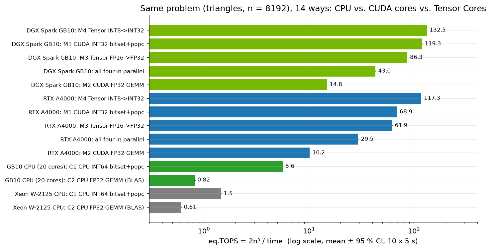
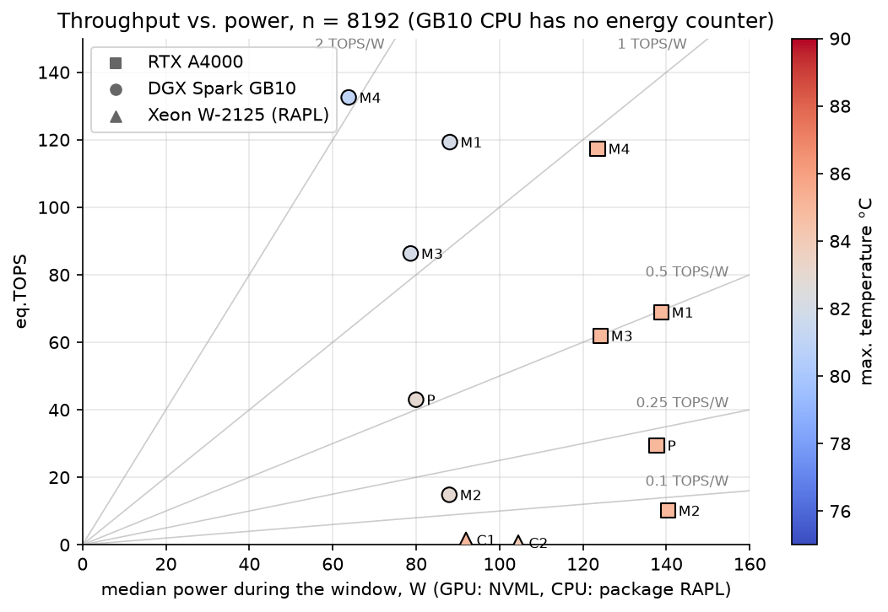
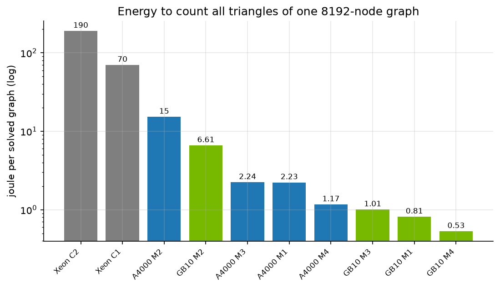
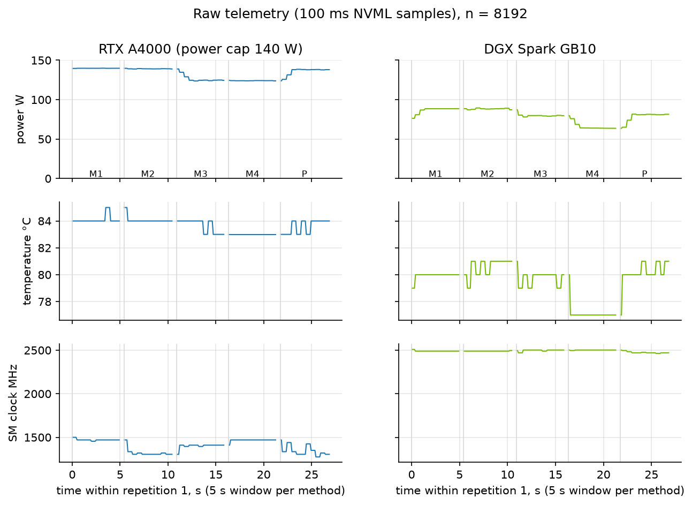
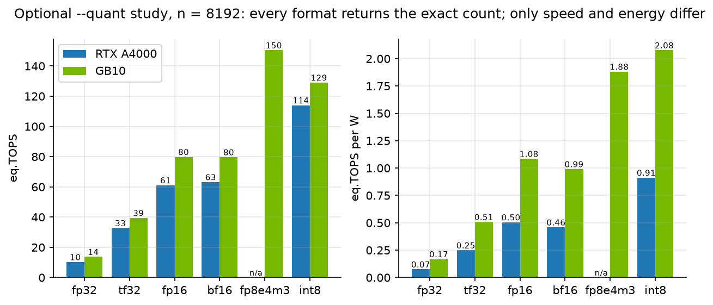
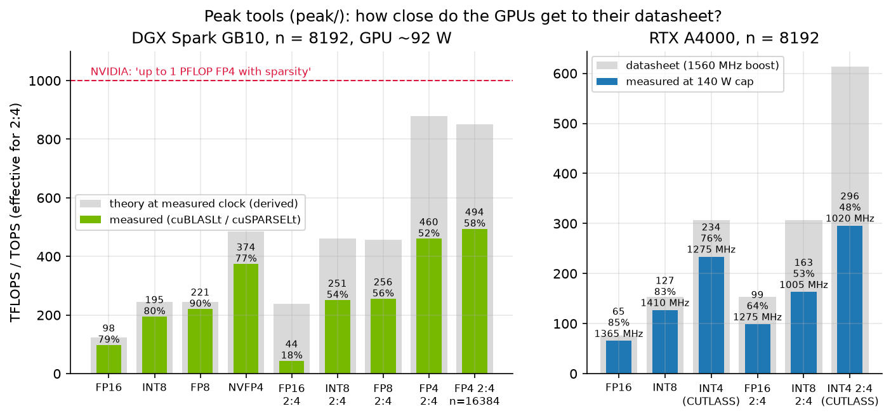
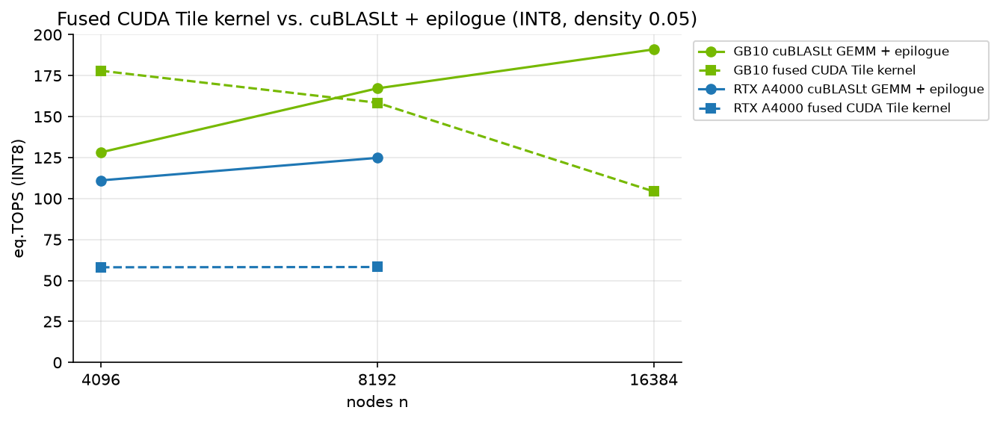

# trianglebench: CUDA cores vs. Tensor Cores on a real math problem

**trianglebench** counts the triangles in a large random graph four times on an NVIDIA GPU, using four
independent methods (two on the CUDA cores, two on the Tensor Cores), and twice more on the CPU. Every
method must return **exactly the same count for every single node**. That turns the benchmark into a
verifiable experiment: each throughput, power and energy figure comes with a proof that the answer is correct.



Contents: [What it does](#what-it-does) · [Who it is for](#who-it-is-for) · [Results](#results) ·
[Theory](#scientific-background) · [Limitations](#limitations) · [Deploy and run](#deploy-and-run) ·
[Output and analysis](#output-and-analysis) · [Correctness](#how-correctness-is-guaranteed) ·
[Repository layout](#repository-layout)

## What it does

| Method | Unit | Arithmetic | How |
|---|---|---|---|
| M1 | CUDA cores | INT32 | own kernel: rows as bitsets, `(A·A)_ij = popcount(row_i AND row_j)` |
| M2 | CUDA cores | FP32 | cuBLASLt GEMM, FP32 *pedantic* (Tensor Cores disabled) |
| M3 | Tensor Cores | FP16 → FP32 | cuBLASLt GEMM, matrix multiply-accumulate `D = A·B + C` |
| M4 | Tensor Cores | INT8 → INT32 | cuBLASLt GEMM, integer matrix multiply-accumulate |
| P | all of them | – | M1–M4 at the same time in separate CUDA streams: do the units add up or compete? |
| C1 | CPU (`trianglebench-cpu`) | INT64 | OpenMP, bitsets + hardware `popcnt` |
| C2 | CPU (`trianglebench-cpu`) | FP32 | OpenBLAS `sgemm` |

What you get:

* **Speed** in eq.TOPS (see [theory](#work-and-the-eqtops-yardstick)), mean ± 95 % confidence interval over
  repetitions with a rotating method order.
* **Power, energy and thermals per method:** median watts, TOPS/W, joules per solved graph, maximum
  temperature, median SM clock and NVML clock-event reasons (power cap, thermal), plus a raw 100 ms
  telemetry trace. On x86 CPUs the package power comes from RAPL.
* **Correctness:** all methods are compared node by node in every repetition; `--selftest` checks them
  against a CPU brute-force count.
* **Graph statistics:** triangle count, global (FP64) and mean local (FP32) clustering coefficient compared
  with random-graph theory.
* **Optional quantisation study** (`--quant`): the same problem in fp32, tf32, fp16, bf16, fp8, int8 and more.
* **Machine-readable output:** JSON with full provenance and a tidy CSV, ready for pandas or R, plus a
  JupyterLab image that analyses everything and exports an HTML report.
* **Peak tools** in [`peak/`](peak): how close the GPU gets to its datasheet (dense, 2:4 sparse, FP8, NVFP4,
  INT4), and a CUDA Tile prototype of a fused kernel.

## Who it is for

* **People choosing or sizing GPU hardware** (e.g. a DGX Spark vs. a workstation card) who want measured
  throughput *and* energy instead of datasheet peaks.
* **CUDA, HPC and ML engineers** who want to see what Tensor Cores, low-precision formats, 2:4 sparsity and power
  caps really do on one well-defined, verifiable workload.
* **Teachers and students** in parallel computing or numerical linear algebra: a compact example of how one
  graph problem maps to bit operations, FP32, FP16 and INT8 arithmetic, with exact answers to check against.
* **Benchmark and energy-efficiency researchers** who need raw per-repetition data, telemetry and
  provenance for their own statistics.

It is **not** an LLM inference benchmark (no tokens/s), a multi-GPU or interconnect test, or a graph-analytics
library for real-world sparse graphs.

## Results

Tested platforms: **x86_64 + RTX A4000** (Ampere, sm_86, PCIe, 140 W) and **aarch64 + NVIDIA DGX Spark**
(GB10 Grace Blackwell, sm_121, unified memory). 10 repetitions × 5 s per method, mean ± 95 % confidence
interval (Student t), sustained load after a 10 s warm-up. Raw data: [`results/`](results/).

```
                              RTX A4000 (140 W)           DGX Spark GB10            GB10 / A4000
n = 8192                      eq.TOPS        W   TOPS/W   eq.TOPS        W   TOPS/W   TOPS   TOPS/W
M1 CUDA INT32 bitset+popc    68.90±0.09  138.8   0.497  119.30±0.09   88.1   1.355   1.73    2.73
M2 CUDA FP32 GEMM            10.15±0.01  140.4   0.072   14.81±0.03   88.0   0.168   1.46    2.33
M3 Tensor FP16->FP32         61.93±0.05  124.2   0.499   86.30±0.18   78.7   1.097   1.39    2.20
M4 Tensor INT8->INT32       117.35±0.07  123.5   0.950  132.54±0.13   63.8   2.077   1.13    2.19
all four in parallel         29.46±0.17  137.7   0.214   42.98±0.10   80.0   0.537   1.46    2.51
median SM clock / T max      1320-1470 MHz / 85 °C       2489-2502 MHz / 83 °C
```

Both systems found the identical 11,456,628,772 triangles (n = 8192) and 1,431,534,897 (n = 4096).
Every difference in the table is significant (Welch t-test, p < 1e-12); the exact values are produced by
`analysis/summarize.py --compare`.

What the data shows:

* **Tensor Cores vs. CUDA cores on the same matrix product:** INT8 Tensor Cores are 12.2× faster than FP32
  CUDA cores on the A4000 (n = 16384) and 8.9× faster on the GB10 (n = 8192). Energy per solution drops by
  12.4× on the GB10 (6.61 J → 0.53 J).
* **Algorithms still matter:** the bitset method on plain CUDA cores beats the FP16 Tensor Cores on both
  GPUs, because one 32-bit `popcount` replaces 32 multiply-adds of 0/1 values. On the A4000 it runs at
  1.08 T popc/s, 95 % of the popcount peak (48 SMs × 16 popc/clock × 1470 MHz, see
  [CUDA Best Practices Guide, native arithmetic throughput](https://docs.nvidia.com/cuda/cuda-c-best-practices-guide/index.html)).
* **Running everything at once does not add up:** the sum of throughput shares stays between 0.92 and
  1.01 (0.99 on both GPUs at n = 8192). The methods share one power budget and the same SMs, so
  parallel execution gives no measurable gain.
* **The GB10 is about 2.2–2.7× more energy-efficient** than the A4000 and faster on every method, but its
  lead on INT8 Tensor Cores is small (1.13×).
* The A4000 was limited by its power cap (`SW power cap` in 100 % of the telemetry samples), not by
  temperature.

### Throughput, power and temperature

Each point is one method at n = 8192; the grey lines are constant efficiency (TOPS/W), the colour is the
maximum temperature during the window. For every method the GB10 delivers more throughput at lower power
(0.17–2.08 TOPS/W, 64–88 W, 81–83 °C) than the A4000 (0.07–0.95 TOPS/W, 124–140 W, 85 °C).





Raw telemetry of one repetition shows how the methods load the GPU differently: on the A4000 the CUDA-core
methods sit at the 140 W cap and lose clock (1320 MHz for FP32), while the INT8 Tensor Cores finish the same
work below the cap.



### CPU: Xeon W-2125 (4 cores / 8 threads) vs. GB10 CPU (10x Cortex-X925 + 10x Cortex-A725)

Same protocol, same graphs, n = 8192, 10 repetitions x 5 s, mean ± 95 % CI. eq.TOPS is the same formula as on
the GPU, so CPU and GPU columns are directly comparable.

| method | Xeon W-2125 | GB10 CPU | GB10/Xeon |
|---|---|---|---|
| C1 INT64 bitset + popcount (eq.TOPS) | 1.456 ±0.005 | **5.625** ±0.024 | 3.86x |
| C2 FP32 GEMM, BLAS (eq.TOPS) | 0.608 ±0.002 | **0.818** ±0.010 | 1.35x |
| native rate C1 | 11.4 G popcnt64/s | 43.9 G popcnt64/s | 3.86x |
| native rate C2 | 608 GFLOP/s FP32 | 818 GFLOP/s FP32 | 1.35x |
| CPU package power (RAPL) | 92 W | not measurable | - |
| eq.TOPS per watt | 0.0158 | - | - |
| joule per solve | 70.1 J | not measurable | - |
| max. temperature | 85 °C | 97 °C (hottest SoC sensor) | - |
| median clock | 4400 MHz (C1) / 3900 MHz (C2) | 3900 MHz | - |
| thermal throttle events | 0 | not reported | - |

CPU vs. GPU at n = 8192, same algorithm (95 % CI from a Welch interval on log eq.TOPS, see `cpu_vs_gpu.csv`):

| comparison | GPU | CPU | speed-up GPU/CPU |
|---|---|---|---|
| bitset + popcount | A4000 M1 68.9 eq.TOPS | Xeon C1 1.456 | 47.3x (47.2 - 47.5) |
| bitset + popcount | GB10 M1 119.3 eq.TOPS | GB10 C1 5.625 | 21.2x (21.1 - 21.3) |
| FP32 GEMM | A4000 M2 10.2 | Xeon C2 0.608 | 16.7x (16.7 - 16.8) |
| FP32 GEMM | GB10 M2 14.8 | GB10 C2 0.818 | 18.1x (17.9 - 18.3) |
| energy per solve | A4000 M1 2.23 J | Xeon C1 70.1 J | 31x more energy on the CPU |
| energy per solve | GB10 M4 INT8 0.53 J | Xeon C1 70.1 J | 132x more energy on the CPU |

The GB10 SoC exposes no CPU energy counter (no RAPL, no hwmon power input), so CPU watts, TOPS/W and joules
stay empty there; only temperature and clock are available. The 97 °C is the maximum over all SoC thermal zones
(`acpitz`), not an identified CPU-only sensor. The Xeon reaches ~66 % of its theoretical AVX-512 FP32 peak in C2,
the GB10 CPU ~48 % of its estimated NEON/SVE2 peak; its OpenBLAS 0.3.26 has no kernel tuned for these cores
(to be confirmed).

### Input formats (`--quant`)

Measured with v1.3.0, n = 8192, 5 repetitions, mean ± 95 % CI (`results/*_quant.*`):



| format | GB10 eq.TOPS | W | TOPS/W | J/solve | RTX A4000 eq.TOPS | W | TOPS/W | J/solve |
|---|---|---|---|---|---|---|---|---|
| fp32 | 13.72 ± 0.07 | 81.5 | 0.168 | 6.63 | 10.21 ± 0.20 | 137.0 | 0.075 | 14.90 |
| tf32 | 39.44 ± 0.21 | 77.6 | 0.508 | 2.19 | 32.73 ± 0.43 | 131.6 | 0.249 | 4.47 |
| fp16 | 79.83 ± 0.31 | 73.6 | 1.085 | 1.02 | 61.08 ± 0.99 | 121.0 | 0.505 | 2.20 |
| bf16 | 79.63 ± 0.12 | 80.4 | 0.991 | 1.11 | 63.16 ± 1.13 | 137.7 | 0.459 | 2.42 |
| fp8e4m3 | **150.42 ± 0.51** | 79.9 | 1.882 | 0.59 | n/a | | | |
| int8 | 129.03 ± 0.38 | 62.1 | **2.077** | **0.53** | **114.00 ± 1.47** | 124.9 | **0.913** | **1.21** |

Every format returned the exact triangle count on every node on both GPUs. Maximum temperature 81-82 °C
(GB10) and 84-85 °C (A4000). On the GB10, FP8 is the fastest input format, INT8 the most energy-efficient one.

### Peak throughput vs. datasheet

The tools in [`peak/`](peak) measure GEMM peaks with autotuned cuBLASLt, cuSPARSELt and CUTLASS kernels, with
vLLM stopped on the DGX Spark. The GB10 reaches 374 TFLOPS NVFP4 dense and 494 TFLOPS FP4 with 2:4 sparsity,
**about half of the advertised "1 PFLOP FP4 with sparsity"**. Sparsity gains only 1.16–1.31× because the sparse
kernels run into the ~92 W GPU power limit and lose clock. Details and the derivation of the theory bars:
[`peak/README.md`](peak/README.md).



A CUDA Tile prototype fuses the trianglebench kernel (A·A, mask and row sum in one kernel, C never written to
memory). It is 1.39× faster than cuBLASLt + epilogue on the GB10 at n = 4096, but slower for larger matrices and
on the A4000, so trianglebench keeps the unfused path.



## Learning CUDA with this repository

[`docs/cuda/`](docs/cuda/README.md) is a short course that connects CUDA theory to the code and the
measurements in this repository: execution model and occupancy, memory hierarchy, roofline and the real
bottleneck, tensor cores and data types, cuBLASLt in practice, and measuring time, energy and clocks.
Every chapter cites the CUDA Programming Guide, points to the exact code, and shows a measured value
from the RTX A4000 or the GB10. Three small experiments in `docs/cuda/examples/` reproduce the key effects.

## Scientific background

### The problem: triangles as a matrix product

For an undirected graph with 0/1 adjacency matrix `A` (symmetric, zero diagonal), `(A·A)_ij` is the number of
common neighbours of `i` and `j`, i.e. the number of paths of length 2. A triangle is a closed path of length 3, so

```
t_i  = ½ Σ_j A_ij · (A·A)_ij        triangles at node i
T    = ⅙ trace(A³) = ⅓ Σ_i t_i      triangles in the graph
```

The per-node count `t_i` also gives the local clustering coefficient `c_i = t_i / C(d_i, 2)` (`d_i` = degree)
and the global clustering coefficient `3T / #connected triples`.

### The random graph and its expected values

The input is an Erdős–Rényi graph G(n, p): every pair `(i, j)` is an edge with probability `p` (default 0.5),
decided by a 64-bit hash of `(seed, i, j)`, so the graph is identical on every machine. Its expected values are

```
E[edges] = C(n,2)·p      E[T] = C(n,3)·p³      E[clustering] = p
```

For n = 8192 this gives E[T] = 11,449,052,160; the measured 11,456,628,772 deviates by 0.066 %, and both
clustering coefficients come out at 0.500. The theory check is a sanity test of the generator and the counting,
the node-by-node agreement of all methods is the actual correctness proof.

### Work and the eq.TOPS yardstick

A dense `n × n` matrix product needs `n³` multiply-adds = `2n³` operations (1.1 × 10¹² for n = 8192). All methods are
reported as **eq.TOPS = 2n³ / time**, the throughput a dense GEMM would need to solve the same problem in the same
time, so different algorithms and units share one axis. For M1 this is an *effective* rate: one 32-bit
`popcount(row_i AND row_j)` replaces 32 multiply-adds (64 operations), so its native rate is eq.TOPS / 64.

### Why every format gives the exact answer

All values are small integers: inputs are 0 or 1 (exact in FP16, BF16, TF32, FP8, INT8) and every entry of `A·A`
is at most `n`. FP32 represents every integer up to 2²⁴ = 16,777,216 exactly, INT32 up to 2³¹. With n ≤ 2²⁴ no
rounding can occur, so every method must agree bit for bit; any difference is a bug, not a precision effect. This
is a property of the 0/1 problem: with weighted graphs or neural-network weights, low-precision formats do lose
accuracy.

### What limits the speed: compute, memory, power

* **Compute bound.** The INT8 GEMM moves at least `6n²` bytes (A and B as INT8, C as INT32) for `2n³`
  operations: an arithmetic intensity of `n/3` ≈ 2,700 operations per byte at n = 8192, far above the machine balance (peak operations / memory bandwidth) of the two GPUs: about 283 op/byte
  for the A4000 (127 TOPS INT8 measured / 448 GB/s datasheet) and about 714 for the GB10 (195 TOPS / 273 GB/s).
  The benchmark therefore measures the arithmetic units and their power supply, not the memory.
* **Peak rate.** `peak = SMs × operations per clock per SM × clock`. Tensor Cores execute a whole small matrix
  multiply-accumulate `D = A·B + C` per instruction; their rate per clock doubles each time the input width halves
  (FP16 → FP8/INT8 → FP4). With **2:4 structured sparsity** two of every four weights are zero; the hardware skips
  them and the *effective* (dense-equivalent) rate doubles again.
* **Power caps and DVFS.** Dynamic power grows roughly with `C·V²·f`. When the board reaches its power limit
  (140 W on the A4000, about 92 W GPU power observed on the GB10), the driver lowers clock and voltage until
  power fits. Throughput then scales with the clock that is left, so **TOPS/W and joules per solve**
  (`E = P · t`) are the meaningful comparisons, and every result is reported with power, temperature and clock.
* **Algorithm vs. hardware.** The bitset method does `n³/32` 32-bit popcounts instead of `n³` multiply-adds. It
  needs no Tensor Cores and still beats FP16 Tensor Cores; INT8 Tensor Cores beat it only because their per-clock
  rate is even higher.

### Statistical design

* **Repetitions are the samples.** Each method gets a fixed measuring window (default 5 s) per repetition; the
  solves inside a window are autocorrelated and are summarised, not counted as samples.
* **Rotating order** (repetition r runs methods r, r+1, r+2, r+3 mod 4), so warm-up and
  heat build-up do not favour one method; `position_in_order` allows testing for order effects.
* **Confidence intervals** use Student t over repetitions; system comparisons use Welch's t-test (unequal
  variances). The notebook adds Holm correction, Hedges' g and a drift test over repetitions.
* **Energy** comes from the NVML energy counter where available, otherwise from the trapezoidal integral of the
  100 ms power samples (`energy_source` in the JSON).

## Limitations

* **One problem, one graph type.** Dense G(n, p) graphs with p = 0.5. Real-world graphs are sparse, where
  algorithms in `O(m^1.5)` beat the `O(n³)` matrix approach by orders of magnitude; trianglebench uses the dense
  form on purpose, to load the arithmetic units.
* **Single GPU, NVIDIA only.** CUDA, cuBLASLt and NVML; compute capability 7.5 or newer. No multi-GPU, no AMD or
  Intel GPUs.
* **Memory:** about `19·n²` bytes (1.3 GB for n = 8192, 5 GB for 16384); `n` must be a multiple of 256.
* **Formats in the quant study** depend on the GPU and on cuBLASLt. trianglebench multiplies a plain row-major
  0/1 matrix, so formats that need packed or block-scaled operands are reported as unsupported, never silently
  replaced:

  | format | RTX A4000 (sm_86) | DGX Spark GB10 (sm_121) |
  |---|---|---|
  | fp32, fp16, bf16, tf32, int8 | yes | yes |
  | fp8e4m3 | no (Ampere has no FP8 Tensor Cores) | yes |
  | fp8e5m2, int4, fp4e2m1 | no | no |

  The "no" entries have three different causes (CUDA Programming Guide 13.4, Table 33, "Input Data Types Supported
  by Tensor Core Acceleration per Compute Capability"):

  | compute capability | TF32 | BF16 | FP16 | FP8 | FP6 | FP4 | INT8 | INT4 |
  |---|---|---|---|---|---|---|---|---|
  | 8.6 (RTX A4000, Ampere) | yes | yes | yes | – | – | – | yes | yes |
  | 12.x (GB10, Blackwell) | yes | yes | yes | yes | yes | yes | yes | – |

  * *Hardware limit:* INT4 on the GB10 and FP8/FP4 on the A4000 do not exist in the Tensor Cores.
  * *Layout limit of this tool:* INT4 on the A4000 and FP4 on the GB10 exist in hardware, but need packed (two
    values per byte) and, for FP4, block-scaled operands (NVFP4: one UE4M3 scale per 16 values), and the
    architecture-specific target (`sm_121a` or `compute_120f`, Programming Guide §5.1.2). The generic
    `-arch=native` build only gets the baseline feature set. The [`peak/`](peak) tools measure these formats separately.
  * *Library limit:* fp8e5m2 exists on the GB10, but cuBLASLt returned no algorithm for e5m2 × e5m2.
* **cuBLASLt picks its kernel by heuristic** (logged as `cublaslt_algo`), not by exhaustive search; a tuned kernel
  can be a few percent faster (the peak tools autotune). On the GB10 the INT8 path used the same algorithm ID as on Ampere.
* **Telemetry depends on what the platform exposes.** On the GB10, NVML reports no power limit, memory clock or
  clock-event reasons, and whether its power figure covers only the GPU is not documented. The GB10 CPU has no
  energy counter at all; CPU power is only measured on x86 via RAPL.
* **Reference runs:** during the GB10 runs a vLLM inference server was loaded but idle on the same GPU
  (95 GB of unified memory reserved, no requests), so the GB10 was not run at n = 16384. Sustained A4000 runs
  reach 85 °C; short runs on a cold card are up to about 5 % faster. Two systems are a case study, not a ranking.

## Deploy and run

### Native build

Requirements: Linux (x86_64 or aarch64), NVIDIA GPU with compute capability 7.5 or newer, CUDA toolkit 12.9+
(13.x recommended) with cuBLASLt and NVML headers (`cuda-nvml-dev-*` package).

```bash
git clone https://github.com/skbotoc1-web/cuda-tensor-bench.git && cd cuda-tensor-bench
make                         # builds for the GPU in this machine (-arch=native)
./trianglebench --selftest   # all four methods vs. CPU brute force, exit code 0 = passed
./trianglebench --n 4096,8192 --repeats 10 --seconds 5 --warmup 10 --label "my system, stock"
```

The last line is the reference protocol used above (about 9 min; add `16384` if the GPU has ≥ 8 GB free).
Stop other GPU workloads first and describe cooling, power limit and background load in `--label`.

CPU-only variant (g++ with OpenMP and OpenBLAS: `apt install g++ libopenblas-dev`):

```bash
make cpu && ./trianglebench-cpu --selftest && ./trianglebench-cpu --n 4096,8192 --repeats 10 --label "my CPU"
```

### Docker

Multi-arch image (amd64 and arm64), needs the NVIDIA Container Toolkit:

```bash
docker build --build-arg GIT_COMMIT=$(git rev-parse --short=12 HEAD) -t trianglebench .
docker run --rm --gpus all trianglebench --selftest
docker run --rm --gpus all --user $(id -u):$(id -g) -v "$PWD:/out" -w /out trianglebench --label "my system"
docker run --rm --user $(id -u):$(id -g) -v "$PWD:/out" -w /out --entrypoint trianglebench-cpu trianglebench --label "my CPU"
```

### Options

| Option | Default | Meaning |
|---|---|---|
| `--n LIST` | 8192 | node counts, multiples of 256, comma separated; memory ≈ `19·n²` bytes (1.3 GB for 8192) |
| `--p` | 0.5 | edge probability |
| `--seed` | 1 | graph seed |
| `--repeats` | 5 | repetitions per size; the method order rotates every repetition |
| `--seconds` | 5 | measuring window per method and repetition |
| `--warmup` | 5 | warm-up seconds per size |
| `--cooldown` | 0 | idle seconds before every window (to study thermal effects) |
| `--label` | – | free text stored in the result file |
| `--out` | `tb_<gpu>_<utc>` | output prefix for `.json` and `.telemetry.csv` |
| `--quant LIST` | none | opt-in quantisation study: any of `fp32, fp16, bf16, tf32, fp8e4m3, fp8e5m2, int8, int4, fp4e2m1`, or `all` |

The exit code is `0` only if all methods agree on every node.

### Optional quantisation study (`--quant`)

```
trianglebench --n 8192 --quant bf16,tf32,fp8e4m3   # three extra formats
trianglebench --n 8192 --quant all                 # every format your GPU supports
```

Every requested format gets its own measuring window in every repetition, right after the rotating windows of
M1–M4, with the same telemetry. The graph is expanded from the same bitset into the input format and multiplied by
cuBLASLt; the per-node result is compared with the exact INT32 count of the same run (`mean_abs_per_node`,
`max_abs_per_node`, `exact_node_fraction`, `total_rel_error`). A wrong count fails the run like a disagreement
between M1–M4. Unsupported formats are listed in `quantization_unsupported` and skipped.

### JupyterLab: measure, analyse and share in one container

The `jupyter` target of the same Dockerfile adds JupyterLab with pinned Python packages (pandas, SciPy,
statsmodels, matplotlib), the analysis notebook and the reference results. It runs on amd64 and arm64.

```bash
docker build --target jupyter -t trianglebench:jupyter .
mkdir -p work
docker run --rm --gpus all --user $(id -u):$(id -g) -p 127.0.0.1:8888:8888 -v "$PWD/work:/work" trianglebench:jupyter
```

Open the `http://127.0.0.1:8888/lab?token=…` link printed in the log. JupyterLab is protected by a random
token and the port is bound to localhost only; from another machine use an SSH tunnel
(`ssh -L 8888:127.0.0.1:8888 user@gpu-host`) instead of exposing the port.

Run a measurement and produce a shareable HTML report without opening the browser:

```bash
docker run --rm --gpus all --user $(id -u):$(id -g) -v "$PWD/work:/work" \
  -e TB_RUN=1 -e TB_LABEL="my system, stock" -e TB_ARGS="--n 4096,8192 --repeats 10 --seconds 5 --warmup 10" \
  trianglebench:jupyter sh -c "cp -n /opt/trianglebench/notebooks/*.ipynb . && \
  jupyter nbconvert --to html --execute trianglebench-analysis.ipynb --output-dir export"
```

The notebook (`work/trianglebench-analysis.ipynb`, copied once, never overwritten) optionally runs the self-test and a
new benchmark (`TB_RUN=1`), loads the reference results and every file in `work/results/`, checks agreement and
identical triangle counts across systems, computes descriptive statistics, plots throughput, efficiency, energy,
telemetry and clock-event reasons, runs Welch t-tests with Holm correction and Hedges' g, checks order effects and
drift, and exports tables, figures and `environment.json` to `work/export/`. Share
`work/export/trianglebench-analysis.html` together with the raw `*.json` and `*.telemetry.csv`.

### Peak tools

```bash
cd peak && make            # tensorpeak, sparsepeak, fusedtri (needs cuSPARSELt; fusedtri needs CUDA >= 13.3)
GPUBENCH_MIN_S=12 python3 gb10run.py ./tensorpeak fp16,int8,fp8,nvfp4 8192
```

See [`peak/README.md`](peak/README.md) for requirements, a container recipe for hosts with an older toolkit and all
results.

## Output and analysis

Every run writes two files:

* **`<prefix>.json`** (schema `trianglebench-result/1`)
  * provenance: tool version, git commit, build architecture, nvcc and host compiler, command line,
    kernel, CPU architecture, GPU name/UUID, compute capability, driver, CUDA runtime, cuBLASLt version,
    power limit, clock offsets, ECC, persistence mode, PCIe link (discrete GPUs), UTC start and end time
  * graph: edges, triangles, theoretical expectation, global (FP64) and mean local (FP32) clustering
  * per method: summary statistics (k, mean, sd, 95 % CI half-width, median, min, max, coefficient of
    variation) for eq.TOPS, seconds per solve, watts, joule per solve and TOPS/W
  * per repetition: position in the rotated order, number of solves, window length, energy and its source,
    max temperature, min/median/max SM clock, OR of all NVML clock-event reasons, and **every single solve time**
  * cuBLASLt algorithm, tile and stage IDs chosen for M2–M4
* **`<prefix>.telemetry.csv`**: raw NVML samples every 100 ms
  (`n, phase, method, repeat, t_s, power_w, temp_c, sm_mhz, mem_mhz, clock_event_reasons`)

Combine and compare result files (Python standard library only):

```bash
python3 analysis/summarize.py results/*.json                          # summary table
python3 analysis/summarize.py results/*.json --csv all_runs_tidy.csv  # one row per window, for R/pandas
python3 analysis/summarize.py a.json b.json --compare                 # ratios + Welch t-test
```

The figures in this README are rendered from the raw files by `analysis/make_figures.py` (needs matplotlib;
CI re-renders them on every commit):

```bash
docker run --rm --user $(id -u):$(id -g) -v "$PWD:/r" -w /r --entrypoint python3 trianglebench:jupyter analysis/make_figures.py
```

## How correctness is guaranteed

* The graph comes from a 64-bit integer hash (splitmix64) of the node pair, identical on CPU and GPU.
* All intermediate values are integers that every format represents exactly (see
  [theory](#why-every-format-gives-the-exact-answer)); `n < 2²⁴` is enforced.
* `--selftest` compares the per-node counts of all four methods with a CPU brute-force count over all node
  triples for five graphs, including the empty and the complete graph (`C(n,3)` triangles).
* Every benchmark repetition checks all methods node by node; the peak tools check against a host reference and
  each has a negative test that must fail.
* CI builds the GPU and CPU binaries, the peak tools for sm_86 and sm_121, executes the analysis notebook and
  re-renders the figures.

## Repository layout

```
src/                 trianglebench.cu (GPU), trianglebench_cpu.cpp (CPU)
analysis/            summarize.py (stdlib statistics), make_figures.py (README figures)
notebooks/, jupyter/ analysis notebook and JupyterLab image
results/             reference runs: JSON + telemetry CSV per system
peak/                datasheet peak tools, CUDA Tile fused-kernel prototype, their results
docs/figures/        figures used in this README
docs/cuda/           CUDA programming notes (theory, code, measurement) and small experiments
Dockerfile, Makefile build recipes; .github/workflows/build.yml is the CI
```

## Contributing results

Pull requests with `results/<gpu>_<label>.json` and `.telemetry.csv` from the reference protocol are
welcome. Please describe cooling, power limit and any other load on the GPU in `--label`.

## License

MIT, see [LICENSE](LICENSE). Built by [BALTX.COM UAB](https://baltx.com).
